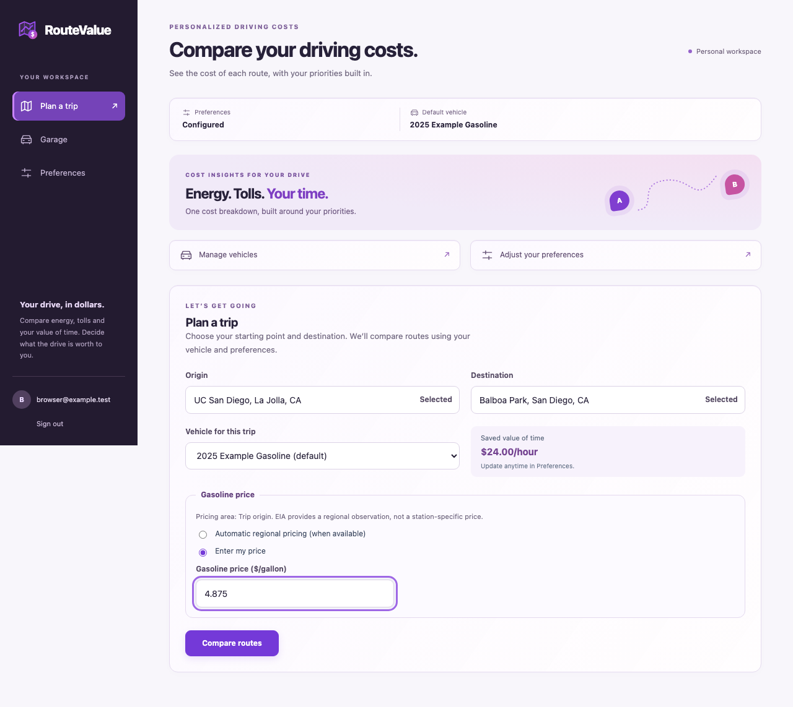
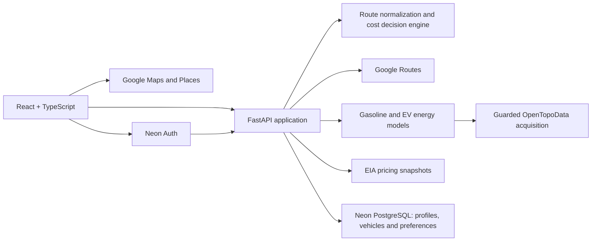

# RouteValue

**Know the cost. Choose what matters.**

RouteValue is a deployed web application that compares driving routes around
**your vehicle, your energy costs and your value of time**. It makes the trade-off
between a faster trip and a cheaper trip explicit, with a personalized cost
breakdown for each eligible route.

[**Try RouteValue**](https://routevalue.pages.dev/) ·
[Architecture decisions](docs/v2-architecture-decisions.md) ·
[Release validation](docs/m11-release-acceptance.md)



## What you can do

- **Compare the cost of alternative routes.** See estimated gasoline or electricity
  costs, tolls, travel duration and the monetary value of your driving time, with
  route selection on an interactive map.
- **Personalize the recommendation.** Decide what an hour of your time is worth;
  a slower route can win when its savings justify the extra time.
- **Save gasoline and electric vehicles.** Select a vehicle configuration from the
  efficiency catalog, keep multiple vehicles and choose a default.
- **Reuse preferences across sessions.** Save your value of time, electricity rate
  and preferred gasoline purchasing area through authenticated accounts.
- **Choose automatic or manual energy pricing.** Gasoline pricing uses published
  EIA regional observations where supported, with a manual override. EV trips use
  a saved electricity rate or an explicit trip override.
- **Understand terrain estimates and their limits.** Optional, user-entered vehicle
  mass enables terrain-aware energy modeling when usable elevation and route
  geometry are available. Missing prerequisites or unavailable coverage produce
  clearly identified baseline estimates.

The recommendation minimizes:

```text
personalized route cost = energy cost + toll cost + travel time × value of time
```

Money uses decimal arithmetic. Routes without required scoring data are marked
ineligible; missing values are not silently treated as free. Numerical ties use
explicit, deterministic rules.

## How it is built

A React/TypeScript interface communicates with a Python/FastAPI backend through a
generated OpenAPI contract. The decision engine is independent of HTTP and routing
providers, with explicit application ports and replaceable infrastructure adapters.



- **Routing and maps:** Google Routes supplies candidates, geometry and available
  toll information; Google Maps and Places support visualization and location entry.
- **Energy:** separate gasoline and EV models, vehicle-efficiency lookup, optional
  manual mass and guarded OpenTopoData elevation acquisition with shared quotas.
- **Persistence and authentication:** Neon PostgreSQL, additive Alembic migrations,
  email/password authentication and JWT-protected, user-owned API resources.
- **Hosting:** Cloudflare Pages frontend, containerized Render backend and isolated
  development/production database and authentication environments.
- **Quality:** pytest, strict mypy and Ruff; Vitest, React Testing Library and
  Playwright; generated API types, production-bundle and container smoke checks.

V2 is deployed at `/` and remains available at `/v2`. The legacy V1 planner is
preserved at [`/v1`](https://routevalue.pages.dev/v1). Source development uses `v2`;
reviewed releases are promoted to `main` for deployment.

## Validation and supported scope

The Safari compatibility release (`bc97b72`, October 21, 2026) passed all four CI
jobs on both `v2` and `main`. Its local frontend checks included 271 tests and ten
production-bundle browser checks, including a real-SDK regression for browsers
without static `Response.json`. These are recorded release results, not a claim
that every future provider request or browser version will succeed.

Live release checks covered saved settings, gasoline/EV trips, automatic and
manual pricing, optional manual vehicle mass, and representative US terrain
routes. Terrain acquisition remains dependent on coverage, geometry and quotas.
EIA observations are regional averages, not station-specific or real-time prices.
Google OAuth, Google Elevation and station-level Google gasoline pricing are not
implemented; the [architecture decision record](docs/v2-architecture-decisions.md)
explains these choices.

Production SMTP hardening and longer-running recovery/alert-delivery observations
remain operating follow-ups. See the [release acceptance record](docs/m11-release-acceptance.md)
and [deployment runbook](deployment/README.md) for evidence, limitations and rollback
instructions. Milestone documents describe the state at their recorded dates;
older references to V2 as local-only are historical.

## Run locally

Use Python 3.13, uv, Node.js 24 and npm. Live integrations require your own
appropriately restricted Google credentials and a separate Neon development
configuration. The examples contain names and defaults, not usable credentials:

- [Backend environment example](backend/.env.example)
- [Frontend environment example](frontend/.env.example)
- [Development configuration and terrain guide](docs/m9-live-terrain-guide.md)

From `backend`, install dependencies and start the API with your private
development environment file:

```sh
uv sync --locked
uv run --env-file .env.v2.local uvicorn routevalue.main:app --reload
```

From `frontend`, provide a private `.env.local` using the example, then run:

```sh
npm ci
npm run dev
```

Vite proxies the local API to `http://127.0.0.1:8000`. Open `/v2` to use the
personalized workflow. Never reuse production credentials for local tests or
commit populated environment files.

## Verification

Backend quality checks, from `backend`:

```sh
uv run ruff check .
uv run ruff format --check .
uv run mypy .
uv run pytest -q
```

The complete backend integration suite requires the designated disposable
PostgreSQL databases and EIA fixtures configured in
[CI](.github/workflows/ci.yml). Do not point it at a development account database
or production.

Frontend checks, from `frontend`:

```sh
npm run api:check
npm run lint
npm run format:check
npm test -- --run
npm run build
npx playwright install chromium
npm run test:e2e
npm run test:release
```

Ordinary browser tests use synthetic integration responses and do not require
live provider keys. Separately opted-in live diagnostics are documented in the
[terrain guide](docs/m9-live-terrain-guide.md).

## Repository layout

```text
backend/src/routevalue/
  api/              HTTP schemas, authentication and resource boundaries
  application/      use cases, orchestration and ports
  domain/           units, energy and deterministic cost decisions
  infrastructure/   provider adapters, persistence and operations
frontend/
  src/              application UI and typed API clients
  e2e/              application browser tests
  release-e2e/      production-bundle and real-SDK browser tests
  openapi/          generated backend contract
.github/workflows/  CI and guarded production EIA maintenance
deployment/         production target identifiers and release runbook
docs/               architecture, milestone evidence and design references
```
