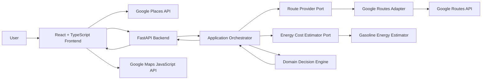

# RouteValue

**RouteValue helps drivers choose the route that costs them less — not just the route that arrives fastest.**

It compares driving routes using a personalized generalized cost that combines:

- fuel cost
- toll cost
- the monetary value of travel time

Instead of assuming the fastest route is always best, RouteValue asks a more useful question:

> Is the time saved by a faster route actually worth the extra money?

## Live Demo

**Production application:**  
https://routevalue.pages.dev

**Production API:**  
https://routevalue-api.onrender.com

**Health check:**  
https://routevalue-api.onrender.com/health

RouteValue V1 is deployed as a production web application with a React frontend on Cloudflare Pages and a containerized FastAPI backend on Render.

---

## What RouteValue Does

For a trip, the user provides:

- origin
- destination
- value of travel time in dollars per hour
- vehicle fuel efficiency in MPG
- gasoline grade
- gasoline price per gallon

RouteValue retrieves multiple candidate routes and evaluates each one using the user's own driving economics.

For each eligible route:

```text
fuel cost
    = estimated gallons used × gas price

direct monetary cost
    = fuel cost + toll cost

time cost
    = travel duration in hours × value of time per hour

generalized cost
    = direct monetary cost + time cost
```

The route with the lowest personalized generalized cost is recommended.

This means RouteValue can intentionally recommend:

- a slower route when its monetary savings are worth the extra time
- a faster route when its time savings justify the extra cost
- a route that is both faster and cheaper

---

## V1 Features

RouteValue V1 includes:

- Google Places autocomplete for origin and destination
- Google Routes integration for real driving-route candidates
- alternative-route comparison
- toll-aware route evaluation
- personalized value-of-time calculations
- gasoline fuel-cost estimation using vehicle MPG and user-supplied gas price
- regular, midgrade, and premium gasoline inputs
- per-route cost breakdowns
- deterministic recommendation logic
- explicit handling of missing route data
- interactive Google route map
- individual route inspection on the map
- responsive production web interface
- stable public FastAPI boundary
- generated OpenAPI-to-TypeScript API contract
- deterministic unit, integration, browser, and container verification

---

## How the Decision Engine Works

RouteValue keeps routing-provider data separate from its core decision logic.

Google provides candidate route information such as:

- distance
- duration
- toll information
- route geometry

RouteValue then normalizes that information into provider-independent domain models before scoring it.

### Route eligibility

A route must have the data required to calculate its generalized cost.

Routes with unavailable required data are not silently assigned guessed values. They are marked ineligible and surfaced explicitly in the result.

### Numerical ties

V1 uses a **$0.10 generalized-cost tie tolerance**.

When multiple routes fall within that tolerance, RouteValue resolves the result deterministically using:

1. shorter travel time
2. lower direct monetary cost
3. shorter distance
4. stable provider order

This keeps route recommendations reproducible.

---

## Architecture

RouteValue is structured so that the decision engine is independent of HTTP, Google APIs, and the frontend.



### Backend boundaries

The backend is divided into:

```text
routevalue/
├── api/              HTTP schemas, mapping, dependencies, error handling
├── application/      orchestration, ports, application models
├── domain/           decision logic, eligibility, units, core models
└── infrastructure/   Google Routes and gasoline-energy adapters
```

The core domain does not depend on FastAPI or Google-specific response models.

External services enter through explicit application ports, which keeps future routing and energy implementations replaceable.

---

## Request Flow

A production trip comparison follows this path:

```text
Cloudflare Pages
        ↓
React / TypeScript frontend
        ↓
Google Places resolves locations
        ↓
Render FastAPI backend
        ↓
Google Routes adapter
        ↓
Google Routes API
        ↓
normalized route candidates
        ↓
gasoline energy estimator
        ↓
RouteValue decision engine
        ↓
personalized recommendation
        ↓
React results + Google route map
```

The backend requests both normal route alternatives and an avoid-tolls route set, then merges unique candidates before evaluation.

---

## Tech Stack

### Frontend

- React 19
- TypeScript
- Vite
- Google Maps JavaScript API
- Places API (New)
- Vitest
- React Testing Library
- Playwright
- ESLint
- Prettier

### Backend

- Python 3.13
- FastAPI
- Pydantic
- httpx
- Uvicorn
- `Decimal`-based monetary calculations
- pytest
- Ruff
- strict mypy
- uv

### Infrastructure

- Google Routes API
- Google Maps Platform
- Docker
- Render
- Cloudflare Pages
- GitHub Actions

---

## Repository Structure

```text
routevalue/
├── .github/
│   └── workflows/
│       └── ci.yml
│
├── backend/
│   ├── src/
│   │   └── routevalue/
│   ├── tests/
│   ├── Dockerfile
│   ├── pyproject.toml
│   └── uv.lock
│
├── frontend/
│   ├── e2e/
│   ├── openapi/
│   ├── src/
│   ├── package.json
│   └── package-lock.json
│
└── README.md
```

---

## Local Development

### Prerequisites

Install:

- Python 3.13
- uv
- Node.js 24
- npm

Docker Desktop is also required for local container verification.

Clone the repository and enter the project directory before continuing.

### 1. Start the backend

```bash
cd backend
uv sync --locked
```

RouteValue requires a Google Routes API key for live trip evaluations.

To enter the key without displaying it in the terminal:

```bash
read -s "GOOGLE_ROUTES_API_KEY?Google Routes API key: "
export GOOGLE_ROUTES_API_KEY
echo
```

Start FastAPI:

```bash
uv run uvicorn routevalue.main:app --reload
```

The backend runs at:

```text
http://127.0.0.1:8000
```

Verify it:

```bash
curl -fsS http://127.0.0.1:8000/health
```

Expected response:

```json
{"status":"ok"}
```

The health endpoint does not require Google credentials.

### 2. Start the frontend

Open another terminal:

```bash
cd frontend
npm ci
```

Enter the browser Google Maps Platform key:

```bash
read -s "VITE_GOOGLE_MAPS_API_KEY?Google Maps API key: "
export VITE_GOOGLE_MAPS_API_KEY
echo
```

Start Vite:

```bash
npm run dev
```

During local development, frontend `/api` requests are proxied to:

```text
http://127.0.0.1:8000
```

so no local CORS configuration is required.

---

## Environment Configuration

### Backend

#### `GOOGLE_ROUTES_API_KEY`

Server-side credential used to call Google Routes.

This must never be committed or exposed to the frontend.

#### `ROUTEVALUE_CORS_ORIGINS`

Optional comma-separated list of frontend origins allowed to call the backend from a browser.

Production currently allows the deployed Cloudflare Pages application.

When unset, CORS middleware is not enabled. This is the normal local-development configuration because Vite proxies backend requests.

### Frontend

#### `VITE_GOOGLE_MAPS_API_KEY`

Browser-visible Google Maps Platform key used for:

- Places API (New)
- Maps JavaScript API

Because Vite embeds this value into the browser bundle, security relies on Google API and website restrictions rather than secrecy.

#### `VITE_API_BASE_URL`

Production FastAPI origin.

When unset, RouteValue defaults to:

```text
/api
```

which preserves the local Vite proxy workflow.

---

## Verification

### Backend

```bash
cd backend

uv run pytest -q
uv run ruff check .
uv run ruff format --check .
uv run mypy .
```

### Frontend

```bash
cd frontend

npm run api:check
npm test
npm run lint
npm run format:check
npm run build
```

### Browser E2E

```bash
cd frontend

npx playwright install chromium
npm run test:e2e
```

The browser E2E suite uses deterministic Google Maps / Places fakes and intercepted API responses, so ordinary CI does not require live Google credentials.

---

## API Contract

The FastAPI OpenAPI schema is the source of truth for the frontend API contract.

The frontend regenerates its TypeScript schema from FastAPI and verifies that committed generated files have not drifted:

```bash
cd frontend
npm run api:check
```

This keeps changes to the HTTP boundary explicit across the Python and TypeScript codebases.

---

## Docker

Build the backend image from the repository root:

```bash
docker build -t routevalue-backend:local ./backend
```

Start the container:

```bash
docker run -d \
  --name routevalue-backend-local \
  -p 8001:8000 \
  routevalue-backend:local
```

Verify the health endpoint:

```bash
curl -fsS http://127.0.0.1:8001/health
```

Expected:

```json
{"status":"ok"}
```

Clean up:

```bash
docker rm -f routevalue-backend-local
```

For live route evaluation, provide the Google Routes key at runtime:

```bash
docker run -d \
  --name routevalue-backend-local \
  -p 8001:8000 \
  -e GOOGLE_ROUTES_API_KEY \
  routevalue-backend:local
```

Credentials are never baked into the container image.

---

## Continuous Integration

GitHub Actions runs on:

- pushes to `main`
- pull requests targeting `main`

The release pipeline verifies four independent areas.

### Backend quality

- pytest
- Ruff lint
- Ruff formatting
- strict mypy

### Frontend quality

- generated API contract consistency
- Vitest
- ESLint
- Prettier
- production Vite build

### Browser E2E

- Playwright Chromium tests

### Backend container

- Docker image build
- container startup
- `/health` smoke test
- deterministic cleanup

No Google API credentials are required by ordinary CI.

---

## Production Deployment

### Frontend

The frontend is deployed on **Cloudflare Pages**.

```text
Production:
https://routevalue.pages.dev
```

Cloudflare builds the frontend from `main` using:

```text
Root directory: frontend
Build command: npm run build
Output directory: dist
```

### Backend

The backend is deployed on **Render** from the existing Dockerfile.

```text
Production:
https://routevalue-api.onrender.com
```

Render automatically deploys backend changes from `main`.

The production health endpoint is:

```text
/health
```

Production CORS explicitly allows the deployed RouteValue frontend.

---

## V1 Limitations

RouteValue V1 deliberately keeps several capabilities outside the initial release scope.

### Gasoline only

V1 models gasoline vehicles using:

- user-provided MPG
- gasoline grade
- user-provided price per gallon

Electric vehicles are not yet supported.

### User-provided gasoline prices

V1 does not automatically retrieve geographic fuel prices.

The user supplies the gasoline price used for the comparison.

### Distance-based fuel estimation

Fuel consumption is currently estimated from route distance and vehicle MPG.

V1 does not yet model changes in efficiency caused by:

- terrain
- elevation
- traffic conditions
- road type
- vehicle speed profile

### Provider-dependent toll information

RouteValue uses toll information returned by Google Routes.

A route that cannot provide the required scoring data is explicitly marked ineligible rather than silently estimated.

### No persistent user accounts

V1 does not currently save:

- vehicles
- value-of-time preferences
- trip history
- other user profiles

Inputs are supplied per evaluation.

---

## Roadmap

Potential post-V1 work includes:

### V1.1+

- automatic geographic gasoline-price lookup
- reusable vehicle and user preferences
- richer route-comparison explanations
- additional deployment and observability improvements

### Future versions

- electric-vehicle support
- route-aware energy consumption
- terrain and elevation modeling
- traffic-sensitive fuel-efficiency estimation
- broader vehicle energy models
- richer personalization policies

The existing application ports and provider-independent domain models are designed so these capabilities can be added without replacing the core decision architecture.

---

## Design Principles

RouteValue V1 was built around several engineering constraints:

- domain logic remains independent of web frameworks
- external providers are accessed through explicit ports and adapters
- money uses exact decimal arithmetic
- canonical domain units are explicit
- missing data is represented rather than guessed
- route decisions are deterministic
- HTTP schemas remain separate from domain models
- frontend types are generated from the backend contract
- provider credentials stay outside source control
- production behavior is verified by automated gates

---

## Status

**RouteValue V1.0 — production deployed**

The application is publicly accessible and the complete production path has been verified:

```text
Cloudflare Pages
→ Render FastAPI
→ Google Routes
→ RouteValue decision engine
→ personalized recommendation
→ Google route map
```